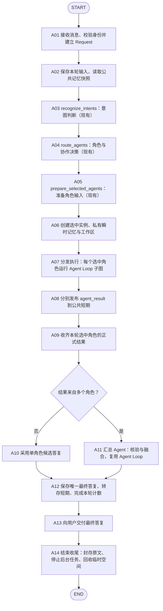
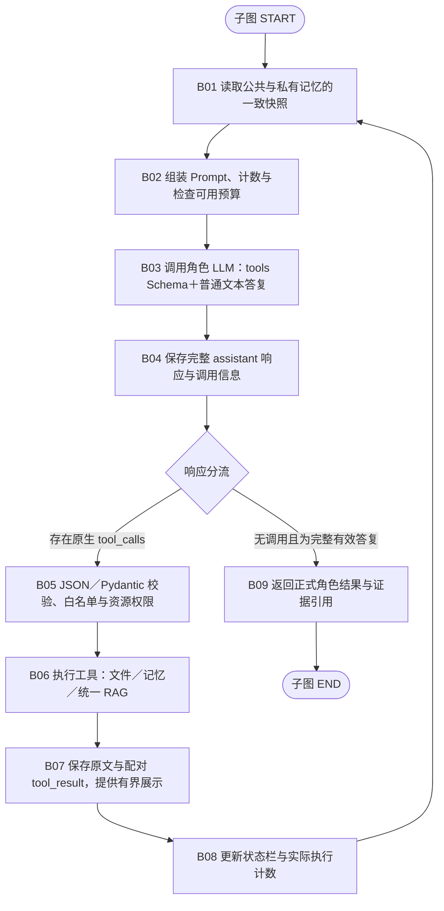
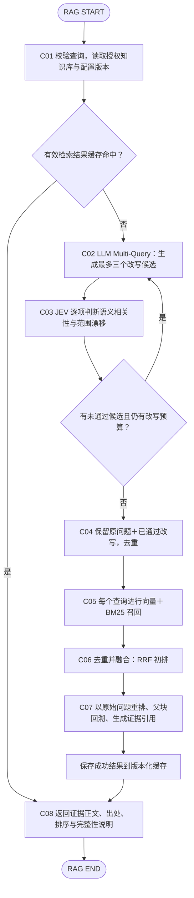

# LangGraph 主图、Agent Loop 与 RAG 子图（v0.2）

日期：2026-10-08。项目：IEEE Access 投稿咨询助手。

状态：正常路径设计图与退出／错误处理讨论稿，不是可运行图或已实施说明。只保存文档，不写业务代码、不调用模型、不改数据库和索引。用户已要求先不写代码，Multi-Query 同样未开始实施。v0.2 记录独立步数计数与状态栏要求，以及建议步数基线、退出原因和混合错误处理；后者仍待用户审阅，完整异常回边和恢复协议尚未冻结。

## 1. 已确认的连接方式

统一 Request 保存原始问题、后台身份、本轮标识、多意图判断、路由与公共记忆快照引用。PromptManager 不依赖 Request 内提前拼好的 context 字符串，而按引用读取并组装。

每个实际参与实例拥有自己的 AgentRun、私有瞬时记忆与文件视图。Request 的公共部分不承载各实例的私有工具轨迹，也不增加独立黑板。各角色返回普通文本，框架关联负责意图、证据引用、来源与状态并发布 agent_result；汇总 Agent 读取正式结果并核验融合，最终输出普通文本。

角色中间结果属于公共短期的协作记录，不混入最近五轮用户／最终助手问答。每轮仅一份最终答复，仅计一次 completed turn。公共短期仍是历史摘要＋最近五轮原始问答，长期仍由短期每 N 个有效完成轮次提取。

## 2. 外层主图：一轮问答

“现有”标记仅表示当前代码已有对应核心节点逻辑；完整 Request、公共记忆、实例执行及持久化尚未接入。当前实际代码仍为 START → recognize_intents → route_agents → prepare_selected_agents → END。

- A04 已包含不明确、非业务、判断冲突和识别服务失败进入通用角色的分类逻辑；“通用兜底”不是一种任意异常都成功恢复的承诺。
- A07 只执行 routing_decision 选中的角色，不启动全部角色。单角色只有一个实例，多角色可动态 fan-out；各实例写入独立私有范围。
- A08 使用 turn_id/agent_run_id/owner 发布独立记录，不覆盖其他角色。A09 按 selected_runs 收齐，而不是“第一个结果返回就汇总”。当前只画正常完成，缺席／失败／超时结果的 barrier 策略下一步讨论。
- A11 不复制所有私有轨迹。汇总输入为原问题、公共条件、负责意图、正式结论、证据和未解决事项。核对覆盖、冲突、适用条件与证据，不按语气或多数票认定正确。
- A12 是轮次完成与记忆沉淀的权威提交点；角色发布不是多次完成问答。最终文本先持久化，再由 A13 交付；网络重复交付与恢复的幂等策略待异常设计。
- A14 清理顺序仍遵循 WorkspaceManager／MemoryManager 设计，保留唯一原文与正式产物。实施可在各实例发布成功后按实例提前收尾，但不能破坏汇总所需引用。

外层正常路径为 DAG。A07/A11 节点内部运行有环子图，所以整个展开系统不是纯 DAG。后续若增加重新路由等回边，外层也将成为有环状态图。

## 3. Agent Loop 子图：所有角色共用

基础节点逻辑共用，角色仅配置提示词、Skill 可见目录及工具白名单。汇总实例同样有独立 run 和私有瞬时记忆，其角色输入按汇总职责适配，权限单独最小化配置。

- B01 同一次读取固定公共版本、私有投影版本；协作结果需要更新时显式取得新快照，不能在组装过程中混读。
- B02 固定前缀为角色、规则、工具定义和 Skill name/description/path；动态部分为长期、短期、当前输入及意图、私有执行记录，最新状态栏在末尾。Schema 由统一 Pydantic 定义生成，服务严格生成支持仍需验证。
- B03 的调用阶段不默认要求用户最终答案为 JSON。B04 保存原生工具调用或文本记录，工具调用期间的文字不作为最终答复交付。
- B05 不从普通文本里的 JSON 猜测工具；只有合法原生调用才执行。非法调用的配对错误与修正策略将在异常设计中补齐。
- B06 不新增写入工具。glob/grep/read 操作文件，query_memory 由 MemoryManager 查询 SQL，search_knowledge 调用统一 RAG。多个工具调用的并发与依赖策略尚未冻结。
- B07 原始记录与展示投影分离，保留调用 ID 配对；大结果按工具契约分页／分段，不在每次返回前调用 LLM 精简。
- B08 步次、实际工具状态、预算由框架生成。状态栏属于瞬时记忆，不独立存储于 PromptManager。
- BD 的空响应、拒绝、截断、服务错误、取消等分支故意未接到最终成功；下一阶段逐项设计。
- B09 的 answer_text 是普通文本，结构化角色元数据与已登记证据引用由框架管理。没有工具调用并不自动证明答案正确，仍应遵循证据约束；本图不虚构自动事实验证器。

## 4. RAG 工具内部子图

这是 search_knowledge 的内部流程，不放在意图识别之前，也不让业务 Agent 分别控制改写、召回和重排。查询改写＋JEV 守门仍是设计，未实现。

- 原问题始终保留。校验不过仅重写未通过项，已通过候选保留；改写次数有限，不无限绕回 C02。
- JEV 核对是否仍服务原问题，是否增添不存在的事实、改变期刊／阶段／主体、把否定改为肯定、擅自扩张诉求。具体接口、阈值、融合权重与实验在 Multi-Query 实施前明确，不从图中推断质量提升。
- 所有查询召回结果按稳定 chunk_id 去重并按有限查询预算融合，不能同一块重复出现就反复作为独立证据计数。原问题用于最终 reranker，防止以改写问题替代用户原意。
- 改写／守门不可用或没有通过候选时回退原问题检索并记录降级；异常详细分类下一阶段补齐。
- 现有代码已有双路召回、单查询 RRF、Qwen reranker 与父块回溯；多查询跨列表融合、缓存和本子图封装未实现。
- 检索缓存键应包含查询／意图提示、知识库版本、模型与检索配置、改写与校验规则版本、授权范围；不复用失效证据，不缓存错误冒充成功。

## 5. 后台支线与服务，不强行变成主图节点

### 5.1 记忆压缩

B02 完整输入达到可用预算的 70% 时通知 MemoryManager；工具旧结果周期压缩也由同一协调器管理。后台读取固定来源 → 生成摘要 → 校验版本与来源 → 发布新投影，B01 在下次调用边界采用。正在进行的 LLM 请求不被改写，原文不被覆盖。

超过硬预算时不能直接沿 B02 → B03 发送；受控等待／停止路径将在异常设计中补齐。图中的正常边隐含“预算允许”，并非取消检查。

### 5.2 短期窗口与长期提取

A12 提交完成轮次后，MemoryManager 更新历史摘要＋最近五轮视图；该用户累计 N 个有效完成轮次时，从短期原文提取长期画像候选，核验来源与冲突后版本化提交。后台提取不要求 A13 等待，也不因此把用户本轮输入重复计数。周期数值尚未冻结。

### 5.3 Redis 与持久化

A02/B01 的公共记忆视图读取和 C01 的 RAG 检索可由后台查 Redis；缓存未命中／不可用时回源 SQL 或检索后端。SQL 与文件是权威存储，Chroma 是知识检索索引，Redis 不是记忆原文真相或模型 KV Cache。第一版不缓存个性化最终答复。

### 5.4 监测与离线入库

各节点产生可关联 request_id/turn_id/agent_run_id 的执行事件，后续监测读取耗时、调用状态、预算、缓存与降级记录；监测体系尚未设计完成。异常设计优先，监测随后讨论。

官方文件解析、清洗、切分、Embedding、Chroma/BM25 建库属于离线 LlamaIndex 链路，不在每轮聊天中重新执行，也不把它们强行改为 LangGraph 在线节点。

## 6. 下一步按节点设计异常

主图重点：A01 身份与输入，A02 存储／记忆读取，A03 判断服务，A07 多实例执行，A08 发布，A09 结果缺席，A11 汇总冲突，A12 幂等转存与计数，A13 交付中断，A14 收尾。

内层重点：B02 输入超预算，B03 模型超时与截断，B04 保存失败，B05 非法调用，B06 工具失败／重复调用，B07 巨大结果与调用配对，B08 无进展与预算，B09 不完整结论。

RAG 重点：缓存版本，改写格式／漂移／预算，JEV 失败，召回与重排降级，证据来源缺失。每个异常明确重试、降级、暂停或终止，并保持有界与原文可追溯。第 7–9 节为本次讨论的退出与错误处理建议，不代表完整异常策略已经获批。

关联现有代码：`src/submission_assistant/graph.py`、`routing.py`、`agents/base.py`、`agents/roles.py`。实现终点仍是输入准备，不能凭设计图宣称已跑通工具循环、记忆、Redis 或汇总。

## 7. 独立计步与状态栏

用户明确：当前步数必须单独计数，并放入 Agent 状态栏；步数上限由工程建议给出，不要求用户凭空选择。

current_step 是本 agent_run_id 的模型决策调用计数，不是用户问答轮数、LangGraph 节点数或工具个数。进入 B03 前持久化递增，模型失败或参数修正也计步；模型一次提出多个工具仍计一个决策步，tool_calls_used 单独计数。网关／传输层有限重试作为同一步的 api_attempts 另行计数，全部计入时间与成本，不成为绕过硬限额的入口。RAG 内部改写／JEV／Embedding 不增加外层 Agent 的决策步，但内部尝试、时间与用量独立记录，并归入整轮总预算。

计数由框架生成并经 MemoryManager 持久化，模型不填写、不修改，压缩和恢复不能归零。每个专业实例、汇总实例独立计步，外层另统计整轮实际消耗，避免并行使总成本失控。

状态栏至少展示 current_step、max_steps、steps_remaining、tool_calls_used、elapsed_ms、remaining_time_ms、已知 token 消耗／剩余预算和当前阶段。未知用量标未知／估算，不伪造精确账单。原问题、负责意图与未解决事项帮助防止目标漂移；完成情况必须有来源，不能仅信任模型自评。

示意：当前步骤 3/8，剩余模型调用 5 次，已请求 2 个工具，阶段=核对检索证据。准备第 4 步时展示 4/8；尚未成功调用的实际 API 消耗由独立计数描述。

预算与计数属于框架真实状态，不能因二级压缩而改变；可压缩的是旧状态描述，不是 current_step、上限、当前阻塞或真实剩余预算。

## 8. 退出策略建议基线

建议第一版每实例最多 8 次模型决策调用（可配置，待真实测试调整）。第 8 次预留为收尾：在工具调用均已配对、时间与 token 预算仍允许时禁用新工具，仅基于已有证据生成答复；不修改工具定义白名单，不新增权限。硬预算已耗尽、取消或致命故障时不额外发起第 9 次“总结”，由后台提供受控未完成说明。总工具次数、整轮时间和费用还须有独立上限，具体数值后续确定，不能以 8 步替代其他限制。

正常结束要求响应无工具调用且完整有效；空响应、拒绝与截断不误判为成功。正常答复可以是答案、必要澄清或证据不足说明，不等于用户业务问题已经解决。

无进展建议：规范化工具名／参数、来源版本、结果指纹与已取得证据一起判断。连续两次相同调用得到相同结果且没有进展时，阻止第三次重复调用，进入受控收尾；不因一次暂时网络失败或来源更新后重查而误判循环。参数字段顺序不同不能逃过检测，已批准的传输重试按单独策略处理。

退出至少覆盖正常答复、step_limit、deadline、token/cost_limit、no_progress、cancelled、unrecoverable_error。实例返回 execution_status（completed/incomplete/cancelled/failed）、stop_reason、可安全使用的答案或部分结论、证据引用与未完成事项。completed 表示本实例完成有效答复，不表示政策一定可回答；异常实例不伪装成功。A09 按终态而非只按成功答案收集，部分失败怎样融合在多 Agent 异常设计中细化。

在 B03 模型调用前、B06 每次工具执行前检查停止条件，B07/B08 更新结果与消耗后再次判断。停止新工具并不省略已接受调用的配对处理，取消／未执行记录由框架保留。退出不删除唯一原文，清理须等待后台任务不再访问来源。

用户取消需要前端／接口明确传播；关闭窗口或普通断线不自动等于用户取消。压缩只减少输入投影，不重置累计消耗与截止时间。

## 9. 混合错误处理与失效模式

采用“框架控制安全与恢复边界，模型调整查询动作”的混合方式。不是把所有失败都抛给模型，也不是一个工具失败就结束整轮。

| 错误类别 | 框架动作 | 模型可以做什么 |
|---|---|---|
| JSON／Schema 不合法、未知工具 | 不执行，返回配对结构化错误 | 在剩余步数内修正为合法已注册调用；连续同类错误建议最多 2 次修正 |
| 文件缺失或不可访问 | 不泄漏额外资源信息，返回安全错误 | 在授权范围用 glob／grep 找正确路径，不扩大权限 |
| 网络超时、限流、暂时性服务失败 | 按工具契约最多 1 次自动重试，仍受原截止时间约束；必要时返回明确降级 | 采用替代授权查询或明确说明服务受限，不无限重试 |
| 无命中、资料不足 | 返回 empty／不足说明，不当成技术失败 | 有依据地换查询，或明确尚未核验，不能把无命中当不存在 |
| 权限不足 | 始终拒绝该动作并记录，不能让模型自行提升权限 | 调整到已有权限内；重复越权由框架终止 |
| 原文持久化失败、身份失效、真实硬预算耗尽 | 停止受影响执行，保护现有来源；不谎报完成 | 不继续工具执行或盲目重试 |

错误返回说明 code、message、retryable 和合法下一步提示，不能直接把异常堆栈、凭证或宿主机路径放入模型上下文。retryable 表示同参数自动重试资格，不禁止模型根据合法提示修改参数；修正次数与自动网络重试不同，均受全局预算限制。

失效模式映射：上下文爆炸→B02 预算与有界工具结果、Memory 异步压缩；工具调用幻觉→B05 原生调用、Pydantic 与权限；死循环→独立步数和无进展检测；目标漂移→保护原问题与负责意图、末尾状态栏展示真实进展。第一版不默认增加每 N 步额外反思 LLM，是否需要显式 reflection 在实测后决定，不能把参考图片里的通用建议自动当成必需节点。
